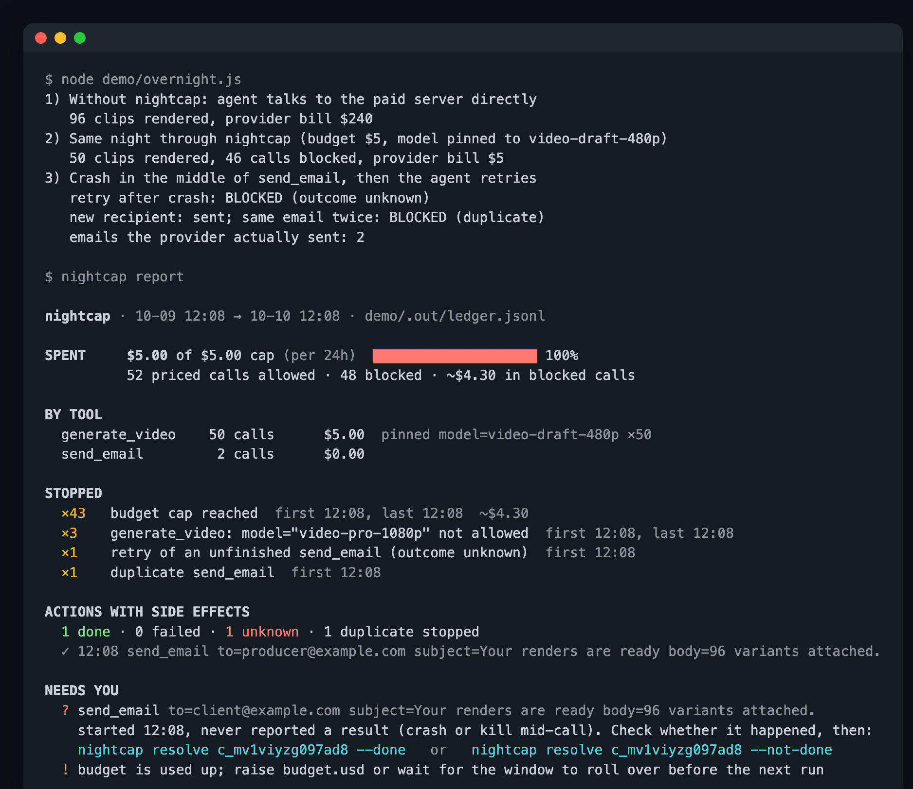

# nightcap

**A hard stop for agents you leave running.** nightcap sits between your agent and its tools. It puts a dollar cap on paid tool calls, pins models and tiers so the agent can't drift to the expensive default, and refuses to repeat an email, form or payment whose outcome it doesn't know. In the morning you get a one-page report.

    



<sub>Screenshot: `npm run demo` against the bundled fake paid server. No real API is called, and the prices are made up for the demo.</sub>

## Why

Your model plan has limits. The tools your agent calls don't.

- An agent left running overnight called a third-party video API on the project's default model. That model cost about 25× the draft tier the author normally used. By morning it had used up the account's $2,500 balance and produced 96 near-identical clips. ([r/ClaudeAI](https://www.reddit.com/r/ClaudeAI/comments/1x1oxol/i_gave_claude_a_batch_job_overnight_woke_up_to_96/); the figures are the author's.) Commenters pointed out that the money went to the video API, not to Claude. The model plan's limits never saw it.
- One developer killed four open-source agents in the middle of an action and let them retry. One charged twice every time, one stayed stuck in "running", and one corrupted its credentials. The common cause was that none of them recorded which actions had already finished. ([r/LLMDevs](https://www.reddit.com/r/LLMDevs/comments/1x1jmuk/i_crashed_four_production_ai_agents_midaction/))
- Prompts like "only use the cheap tier" or "ask me before spending" are suggestions to the model. They aren't enforced.

nightcap enforces them outside the model, at the point where tool calls go out.

## Quick start

**1. Write a policy** (an example with placeholder prices):

```bash
npx -y github:thinx-pro/nightcap init        # writes ./nightcap.json
```

**2a. Any MCP client: wrap the paid server.** Put `nightcap run --` in front of the server command in your MCP config:

```json
{
  "mcpServers": {
    "video": {
      "command": "npx",
      "args": ["-y", "github:thinx-pro/nightcap", "run", "--policy", "/path/to/nightcap.json",
               "--", "npx", "-y", "your-video-mcp-server"]
    }
  }
}
```

**2b. Or Claude Code: add it as a hook.** This also covers `Bash` commands, such as `curl` to a paid API:

```bash
npm i -g github:thinx-pro/nightcap
nightcap hook --print-settings      # paste into .claude/settings.json
```

**3. In the morning:**

```bash
npx -y github:thinx-pro/nightcap report
```

Want to try it without touching a real API first? Clone the repo and run `npm run demo`.

## What a policy looks like

```json
{
  "budget": { "usd": 20, "per": "24h", "maxPerCall": 5 },
  "rules": [
    {
      "tool": "*generate_video",
      "pin": { "model": ["video-draft-480p", "video-std-720p"] },
      "max": { "duration_s": 10 },
      "price": { "by": "model", "table": { "video-draft-480p": 0.02, "video-std-720p": 0.08 },
                 "per": "duration_s", "perDefault": 5 }
    },
    { "tool": "*send_email", "sideEffect": true, "maxCalls": 20 },
    { "tool": "*create_payment", "deny": true, "reason": "no payments while unattended" },
    { "tool": "Bash", "match": { "command": "curl .*api\\.example-video\\.com" }, "price": 2, "sideEffect": true }
  ]
}
```

| Field | What it does |
|---|---|
| `budget.usd`, `budget.per` | Hard cap over `24h` (rolling), `day` (calendar), `session`, or `total`. Calls still in flight count against it. |
| `budget.maxPerCall` | Refuse any single call estimated above this. |
| `rules[].tool` | Tool name or glob. Claude Code names MCP tools `mcp__<server>__<tool>`, so `*generate_video` matches both forms. The first matching rule wins. |
| `rules[].match` | Only apply the rule when the arguments match these regexes (useful for `Bash`). |
| `rules[].pin` | Allowed values per argument. The first value is the default. |
| `rules[].max` | Upper limits for numeric arguments. |
| `rules[].price` | A flat USD amount, or `{by, table, per, perDefault, base, default}`. `by` can be a list of arguments (the table key is then joined with `\|`). A call nightcap can't price is **blocked** rather than guessed. |
| `rules[].sideEffect` | Turns on the action ledger for this tool (see below). |
| `rules[].maxCalls` | Most calls allowed per budget window. |
| `rules[].deny` | Never allowed. `reason` is shown to the agent. |
| `unknownTools` | `allow` (default) or `deny` for tools that match no rule. |

Before leaving, check the policy with dry runs. These write nothing:

```bash
nightcap check generate_video '{"prompt":"x"}'                 # ALLOW  ~$0.10  pinned model=video-draft-480p
nightcap check generate_video '{"model":"video-pro-1080p"}'    # BLOCK  model="video-pro-1080p" is not allowed ...
```

## How it works

- **Proxy mode** (`nightcap run`) speaks MCP over stdio between the client and the real server. Each `tools/call` is checked and logged before it's forwarded. A blocked call comes back as a tool error whose text gives the reason, so the agent sees why and can stop. nightcap also annotates `tools/list`: it adds the price to each tool's description and narrows pinned arguments to an `enum` in the input schema, so the model picks an allowed value in the first place. When a pinned argument is missing, nightcap fills in the default. That covers the "agent used the project default" case.
- **Hook mode** (`nightcap hook`) applies the same policy through Claude Code's `PreToolUse` / `PostToolUse` / `PostToolUseFailure` hooks. A blocked call gets a `deny` with the reason. An allowed call gets *no output*, so your normal permission rules still apply. In this mode nightcap never rewrites a call. If a pinned argument is missing, it denies the call and tells the agent which value to pass.
- **The ledger** is append-only JSONL at `.nightcap/ledger.jsonl` next to the policy. Every entry is fsync'd *before* the call is forwarded, under a cross-process lock, because Claude Code can run tool calls in parallel and each hook is its own process.
- **Side-effect calls** are keyed by a hash of the tool name and canonical arguments:
  - The call has a result → an identical call is **refused as a duplicate**.
  - It started but never finished (crash, kill, timeout) → its outcome is **unknown**. The retry is refused until a human runs `nightcap resolve <id> --done` or `--not-done`. Marking it `--not-done` also takes it out of the budget.
  - It failed explicitly → a retry is allowed.
- **Fail closed:** if nightcap can't evaluate a call (bad ledger, lock timeout), it blocks the call. The one exception is hook mode in a project with no `nightcap.json`, where it does nothing.

## Limitations

- **The prices are yours.** nightcap doesn't know any provider's rates. The example uses placeholders. The cap is only as accurate as your price table, and it's an estimate made *before* each call, not the provider's invoice.
- **Calls are charged when they start.** A call that fails after reaching the provider still counts against the budget, because it may still have been billed. Use `resolve --not-done` to give the money back to the budget.
- Duplicate detection only catches **identical** arguments. A retry with a slightly different subject line is a new call. Add `maxCalls` as a backstop.
- Proxy mode covers stdio MCP servers. HTTP/SSE MCP servers aren't proxied yet; use hook mode in Claude Code for those.
- Hook mode only sees what Claude Code exposes as tool calls. A script the agent writes and runs that calls an API internally looks like one `Bash` call, so match it by command pattern.

Roadmap: HTTP MCP transport, an hourly spend notification hook, a shared price table for common providers (each price sourced), and `report --html`.

## Bundled Skill

[`skills/overnight-preflight/SKILL.md`](skills/overnight-preflight/SKILL.md) is for Claude Code (or any agent that reads Skills). Before a long unattended run, it has the agent list the paid tools, estimate cost, write `nightcap.json`, dry-run it and ask you for the cap. Copy the folder into `.claude/skills/`.

## Development

```bash
npm test        # 26 tests: engine, real stdio proxy with a crash mid-call, hook mode, CLI
npm run demo    # the screenshot above
```

## License

MIT

If nightcap saved you a bad morning, a ⭐ helps other people find it.

---

### 中文说明

**nightcap**：给无人值守的 Agent 装一个「硬刹车」。模型的额度只管模型调用，管不到 Agent 调用的付费工具（视频、图像、搜索）和有副作用的动作（发邮件、提交表单、付款）。nightcap 夹在 Agent 和工具之间：按你写的价目表给每次工具调用估价，超过美元上限就硬性拒绝；把模型和档位钉死，Agent 没指定时自动填入便宜档；对有副作用的动作先写日志再执行，进程崩溃后再重试时，会拒绝「结果未知」的那一次，等人确认后用 `nightcap resolve` 放行；早上用 `nightcap report` 看一页报告。支持两种接入方式：任何 MCP 客户端都可以用 stdio 代理（`nightcap run -- <原服务器命令>`），Claude Code 也可以用 Hook（同时覆盖 Bash）。零依赖，数据只写本地。价格需要你自己填写，示例里的数字都是占位。
